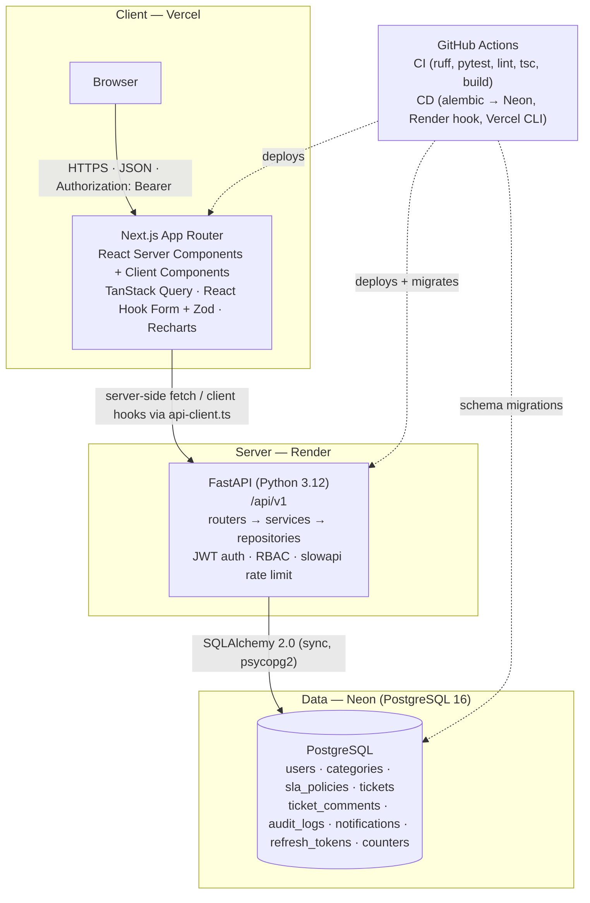
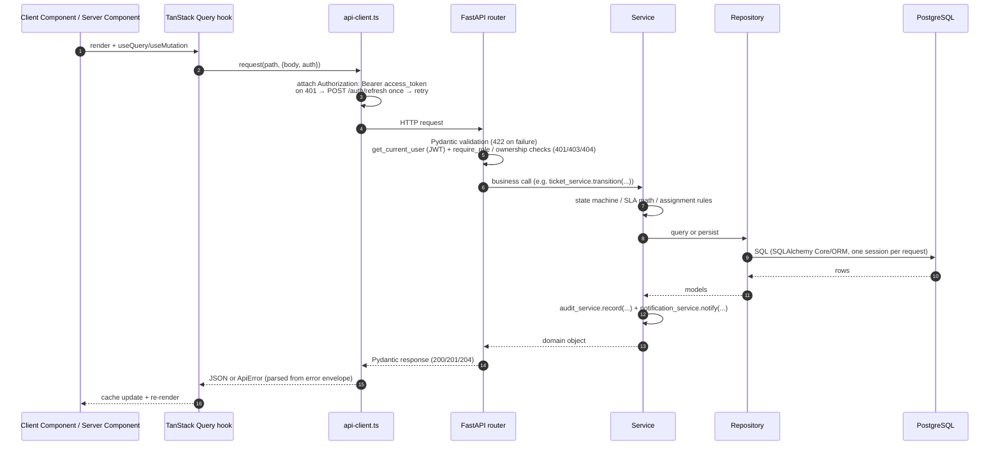
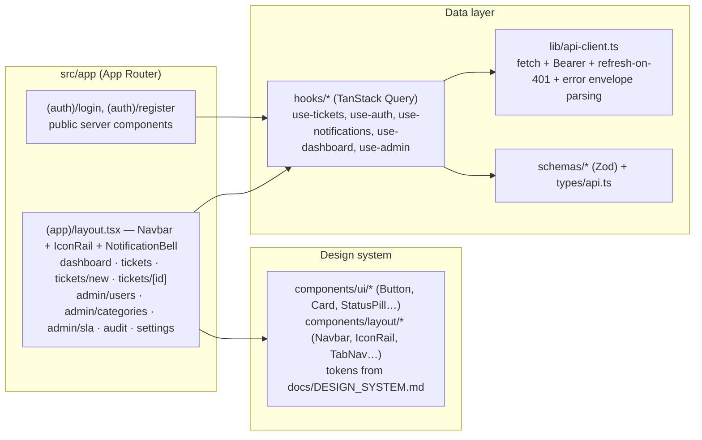
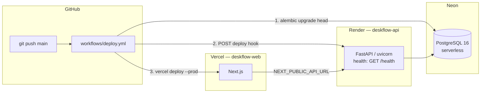

# Architecture — DeskFlow

| | |
|---|---|
| Scope | System design, request flow, layering, cross-cutting concerns, key decisions |
| Related | [DATABASE_SCHEMA](DATABASE_SCHEMA.md) · [API_SPEC](API_SPEC.md) · [BACKEND_SPEC](BACKEND_SPEC.md) · [FRONTEND_SPEC](FRONTEND_SPEC.md) · [DEPLOYMENT](DEPLOYMENT.md) |

## 1. System overview



Environments: **local** (Postgres in Docker Compose, API + web on the same machine, hot reload), **production** (Neon + Render + Vercel). Identical code in both; only env vars differ ([ENVIRONMENT](ENVIRONMENT.md)).

## 2. Request flow

Two paths reach the API; both end in the same router → service → repository pipeline.



- One **DB session per request**, opened by the `get_db` dependency, committed on success, rolled back on any exception (including a failed audit write — an unaudited mutation must not persist).
- Mutations use **TanStack Query mutations** with explicit `invalidateQueries` for the affected keys (e.g. `['tickets']`, `['dashboard']`, `['notifications']`).

## 3. Backend layering

Strict, one-directional layering (enforced by convention + review; routers never import repositories' SQL helpers):

```
HTTP  →  app/api/v1/routers/*     validation, auth deps, status codes; no business logic, no SQLAlchemy
Domain→  app/services/*           business rules: state machine, SLA, assignment, audit, notifications; orchestrates repositories
Data  →  app/repositories/*       all SQL queries & persistence; no business rules
Model →  app/models/*             SQLAlchemy 2.0 mapped classes (mirror DATABASE_SCHEMA.md)
```

Supporting packages:

- `app/core/` — `config.py` (pydantic-settings), `security.py` (argon2 + JWT), `deps.py` (`get_db`, `get_current_user`, `require_role`), `errors.py` (typed exceptions + global handler producing the error envelope), `rate_limit.py` (slowapi), `logging.py`.
- `app/schemas/` — Pydantic v2 request/response models (the wire contract; must match [API_SPEC](API_SPEC.md)).
- `app/db/` — `session.py` (`engine`, `SessionLocal`, `get_db`), `base.py` (`DeclarativeBase`), `seed.py` (demo data).
- `alembic/` — migrations generated from model metadata; `versions/` is the schema history.

Rules:

- Services receive a `Session` via dependency injection and return ORM objects or Pydantic schemas; they never touch `Request`/`Response`.
- Every mutation calls `audit_service.record(...)` in the **same transaction** as the change ([WORKFLOWS §7](WORKFLOWS.md#7-audit-log-actions)).
- Enums and constant values live once, in `app/models/enums.py`, and are mirrored on the frontend in `src/lib/constants.ts`.

## 4. Frontend architecture



- **Route groups:** `(auth)` — unauthenticated pages with a minimal layout; `(app)` — authenticated shell (navbar, icon rail, notification bell) wrapping every protected page.
- **Server vs client components:** pages are server components by default (fast first paint, metadata). Anything interactive — forms, filters, tables with pagination, charts, the bell, countdowns — is a client component `"use client"`. Auth state lives in a client `AuthProvider` context.
- **Data fetching:** exclusively through TanStack Query hooks in `src/hooks/`; `staleTime` 30 s for lists, 60 s for dashboard; polling only for `unread-count` (30 s). Components never call `fetch`.
- **Auth token handling:** access token in memory (context), refresh token in `localStorage`; the single `api-client.ts` performs one silent refresh on 401 and retries. Route guards (`middleware.ts` for redirect + client `RoleGuard` for rendering) protect pages; the backend re-checks everything.
- **Forms:** React Hook Form + Zod schema per form; server errors from the envelope are mapped onto fields via `error.details`.

## 5. Cross-cutting concerns

### 5.1 Error handling format

One shape for every non-2xx response ([API_SPEC §2](API_SPEC.md#2-standard-envelopes)):

```json
{
  "error": {
    "code": "INVALID_TRANSITION",
    "message": "Cannot move a ticket from OPEN to CLOSED.",
    "details": [{ "field": "status", "issue": "Allowed next statuses: IN_PROGRESS, ON_HOLD" }]
  }
}
```

- Mapped centrally by an exception handler in `app/core/errors.py`: `AppError` subclasses carry `code` + `status_code`; Pydantic `RequestValidationError` → `422 VALIDATION_ERROR` with per-field details; unhandled exceptions → `500 INTERNAL_ERROR` with a generic message (stack traces only in server logs).
- Frontend `api-client.ts` throws a typed `ApiError { code, message, details, status }`; hooks surface it; forms map `details` to fields, otherwise a toast shows `message`.

### 5.2 Logging

- Structured JSON logs to stdout (Render/Vercel capture them): `timestamp`, `level`, `request_id` (middleware-injected UUID), `method`, `path`, `status_code`, `duration_ms`, `user_id` (when authenticated).
- Never log passwords, tokens, or full request bodies of `/auth/login`.

### 5.3 CORS

- `CORS_ORIGINS` env var (comma-separated); production value `https://deskflow-web.vercel.app`; local `http://localhost:3000`. Credentials mode off (Bearer tokens, not cookies). Methods `GET, POST, PATCH, PUT, DELETE, OPTIONS`; headers `Authorization, Content-Type`.

### 5.4 Pagination

- Offset pagination everywhere: query `page` (≥1, default 1), `page_size` (1–100, default 20); response envelope `{items, page, page_size, total, pages}` ([API_SPEC §2](API_SPEC.md#2-standard-envelopes)). Sorting via `sort` param, `-field` meaning descending.

### 5.5 Time

- All timestamps stored and returned in **UTC**, ISO-8601 with `Z` (e.g. `2026-10-17T09:23:11Z`). Backend computes all SLA state; the frontend only renders `sla_state` and counts down to `*_due_at` using the client clock delta.

### 5.6 IDs

- Primary keys are UUID v4 (`uuid4` in Python, `gen_random_uuid()` default in Postgres). Human-facing ticket numbers are `TCK-####` from the `counters` table ([DATABASE_SCHEMA §tickets](DATABASE_SCHEMA.md#3-tables)).

## 6. Key design decisions & rationale

| # | Decision | Rationale | Tradeoff accepted |
|---|---|---|---|
| D1 | **Sync SQLAlchemy 2.0 + psycopg2** (not async) | A 1-day build cannot afford async plumbing everywhere (session, migrations, test fixtures, seed). FastAPI runs sync endpoints in a threadpool; at this scale throughput is irrelevant. | Not suitable for thousands of concurrent DB-bound users. |
| D2 | **Repository layer despite small size** | Screening criterion: shows clean architecture. Keeps SQL in one place, makes services testable. | Slightly more boilerplate. |
| D3 | **Refresh tokens in `localStorage`, access in memory** | Vercel (frontend) ↔ Render (API) are cross-site; `SameSite=None` cookies on free tiers are a config time sink and a CSRF surface. Honest tradeoff documented in [AUTH_AND_SECURITY §3](AUTH_AND_SECURITY.md#3-token-storage-frontend). | XSS would expose the refresh token — mitigated by strict CSP-ready code, no `dangerouslySetInnerHTML`, dependency hygiene. |
| D4 | **SLA state computed on read, breach flag persisted** | `ON_TRACK`/`AT_RISK` depend on "now" — storing them would go stale. Only the irreversible `sla_breached` boolean is persisted (for KPIs + one-shot notifications), updated on ticket reads/mutations and by the `internal/sla-scan` endpoint. | A ticket nobody reads stays un-flagged until the scan runs; acceptable — the scan endpoint exists and is trivially cron-able. |
| D5 | **Due dates shifted forward on resume from ON_HOLD** (instead of storing a pause offset only) | Keeps "time remaining" a trivial `due_at - now` for the UI; pause math stays in one place (the resume handler). | Naive `due_at - now` while currently paused would be wrong — the UI checks `paused_at` and shows "Paused". |
| D6 | **Append-only audit via service writes + DB trigger** | Defense in depth: application forgetfulness is caught in review/tests; direct SQL tampering is blocked by a trigger that raises on UPDATE/DELETE of `audit_logs`. | Trigger adds one Alembic migration step. |
| D7 | **Polling (30 s) instead of WebSockets** | WebSocket infra on Render free tier is unreliable; polling is demo-proof and ~30 lines of code. | Up to 30 s latency for notifications. Listed as stretch S3. |
| D8 | **Monorepo** | One clone, one CI, docs next to code — ideal for a 1-day build and for review. | Separate deploys still required (Render/Vercel point at subdirs). |
| D9 | **Alembic migrations run from CI/CD, not from the app** | Render's ephemeral filesystem + single web process makes app-start migrations racy; running `alembic upgrade head` in the deploy workflow is deterministic and visible in the Actions log. | Requires `NEON_DATABASE_URL` secret kept in sync. |
| D10 | **shadcn/ui-style components hand-written** (Radix + cva, no CLI) | Full control of tokens (orange accent, 24px radii) and no generator output to fight; matches the reference dashboard exactly. | Cannot later run `npx shadcn add` blindly — components are already ours. |

## 7. Deployment topology



Details, secrets and smoke tests: [DEPLOYMENT](DEPLOYMENT.md).
