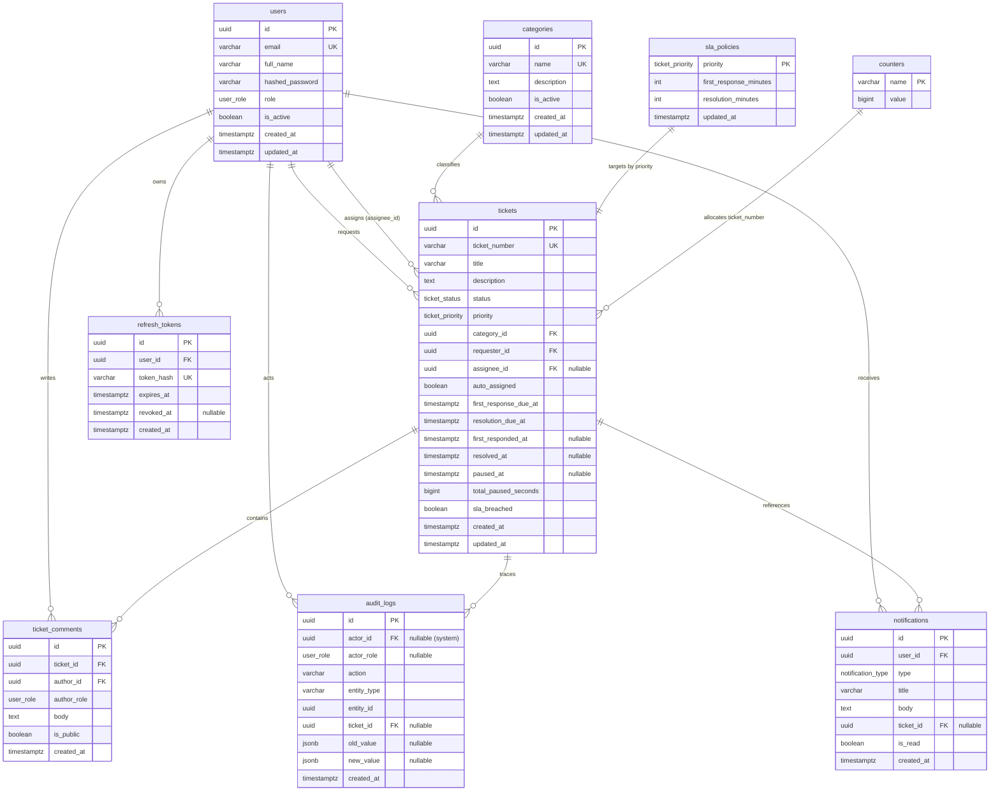

# Database Schema — DeskFlow

| | |
|---|---|
| Engine | PostgreSQL 16 (local: Docker Compose `db` service; prod: Neon) |
| Access | SQLAlchemy 2.0 (sync) models in `backend/app/models/`; schema managed exclusively by Alembic migrations |
| Conventions | snake_case; UUID v4 primary keys (`gen_random_uuid()`); all timestamps `TIMESTAMPTZ` in UTC; soft deletion via `is_active` flags (no hard deletes on users/categories); enums as native Postgres `ENUM` types |

## 1. Enum types

| Enum | Values | Used by |
|---|---|---|
| `user_role` | `requester`, `agent`, `admin` | `users.role`, `audit_logs.actor_role`, `ticket_comments.author_role` |
| `ticket_status` | `OPEN`, `IN_PROGRESS`, `ON_HOLD`, `RESOLVED`, `CLOSED`, `REOPENED` | `tickets.status` |
| `ticket_priority` | `LOW`, `MEDIUM`, `HIGH`, `CRITICAL` | `tickets.priority`, `sla_policies.priority` |
| `notification_type` | `TICKET_ASSIGNED`, `COMMENT_ADDED`, `STATUS_CHANGED`, `SLA_AT_RISK`, `SLA_BREACHED` | `notifications.type` |

- SLA state (`ON_TRACK`, `AT_RISK`, `BREACHED`) is **computed on read**, never stored (except the `tickets.sla_breached` boolean flag).
- Ticket number format: `TCK-1042` — literal prefix `TCK-` + value from the `counters` table (`UPDATE ... RETURNING` row lock in the create transaction; see [WORKFLOWS §8](WORKFLOWS.md#8-ticket-number-allocation)).

## 2. ERD

`sla_policies` is keyed by `priority` (one row per priority) — shown as `||--||` because each priority targets many tickets, but there is exactly one policy row per priority value.

## 3. Tables

### 3.1 `users`

| Column | Type | Null | Default | Notes |
|---|---|---|---|---|
| `id` | `uuid` | no | `gen_random_uuid()` | PK |
| `email` | `varchar(255)` | no | — | lowercased before insert; `UNIQUE` index `uq_users_email` |
| `full_name` | `varchar(120)` | no | — | |
| `hashed_password` | `varchar(255)` | no | — | argon2id hash (`argon2$...`) |
| `role` | `user_role` | no | `'requester'` | |
| `is_active` | `boolean` | no | `true` | soft delete; deactivation revokes refresh tokens |
| `created_at` | `timestamptz` | no | `now()` | |
| `updated_at` | `timestamptz` | no | `now()` | app-managed on update |

Indexes: `uq_users_email (email) UNIQUE`; `ix_users_role (role)`.

### 3.2 `categories`

| Column | Type | Null | Default | Notes |
|---|---|---|---|---|
| `id` | `uuid` | no | `gen_random_uuid()` | PK |
| `name` | `varchar(80)` | no | — | `UNIQUE` index `uq_categories_name` |
| `description` | `text` | yes | `NULL` | |
| `is_active` | `boolean` | no | `true` | inactive → not selectable for new tickets |
| `created_at` | `timestamptz` | no | `now()` | |
| `updated_at` | `timestamptz` | no | `now()` | |

Seed rows: Hardware, Software, Network, Access & Accounts, Email, Other.

### 3.3 `sla_policies`

| Column | Type | Null | Default | Notes |
|---|---|---|---|---|
| `priority` | `ticket_priority` | no | — | PK (one row per priority) |
| `first_response_minutes` | `integer` | no | — | 1–10080; must be ≤ `resolution_minutes` |
| `resolution_minutes` | `integer` | no | — | 1–10080 |
| `updated_at` | `timestamptz` | no | `now()` | |

Default seed values (admin-editable):

| Priority | `first_response_minutes` | `resolution_minutes` |
|---|---|---|
| `CRITICAL` | 60 (1 h) | 240 (4 h) |
| `HIGH` | 240 (4 h) | 1440 (24 h) |
| `MEDIUM` | 480 (8 h) | 2880 (48 h) |
| `LOW` | 1440 (24 h) | 4320 (72 h) |

Changes apply to newly created tickets only ([PRD US-B4](PRD.md)).

### 3.4 `tickets`

| Column | Type | Null | Default | Notes |
|---|---|---|---|---|
| `id` | `uuid` | no | `gen_random_uuid()` | PK |
| `ticket_number` | `varchar(16)` | no | — | `TCK-####`, allocated from `counters`; `UNIQUE` index `uq_tickets_ticket_number` |
| `title` | `varchar(200)` | no | — | 5–200 chars |
| `description` | `text` | no | — | ≥ 10 chars |
| `status` | `ticket_status` | no | `'OPEN'` | state machine in [WORKFLOWS §3](WORKFLOWS.md#3-transition-table) |
| `priority` | `ticket_priority` | no | `'MEDIUM'` | |
| `category_id` | `uuid` | no | — | FK `fk_tickets_category` → `categories.id` `ON DELETE RESTRICT` |
| `requester_id` | `uuid` | no | — | FK `fk_tickets_requester` → `users.id` `ON DELETE RESTRICT` |
| `assignee_id` | `uuid` | yes | `NULL` | FK `fk_tickets_assignee` → `users.id` `ON DELETE SET NULL`; must be role `agent`/`admin` (enforced in service) |
| `auto_assigned` | `boolean` | no | `false` | set when the auto-assigner claimed it at creation |
| `first_response_due_at` | `timestamptz` | no | — | `created_at + first_response_minutes`; shifted forward by pause deltas |
| `resolution_due_at` | `timestamptz` | no | — | `created_at + resolution_minutes`; shifted forward by pause deltas |
| `first_responded_at` | `timestamptz` | yes | `NULL` | set once by first agent/admin public comment or qualifying status change ([WORKFLOWS §4.2](WORKFLOWS.md#42-first-response)) |
| `resolved_at` | `timestamptz` | yes | `NULL` | **first** entry into `RESOLVED`; never cleared (reopen keeps it); used for resolution-SLA compliance |
| `paused_at` | `timestamptz` | yes | `NULL` | set on entering `ON_HOLD`; non-null ⇔ SLA clock frozen |
| `total_paused_seconds` | `bigint` | no | `0` | accumulated pause time across all ON_HOLD episodes |
| `sla_breached` | `boolean` | no | `false` | persisted breach flag; set once (never cleared) when either target is breached ([WORKFLOWS §5.4](WORKFLOWS.md#54-breach--at-risk-detection)) |
| `created_at` | `timestamptz` | no | `now()` | |
| `updated_at` | `timestamptz` | no | `now()` | |

Indexes: `ix_tickets_status (status)`; `ix_tickets_priority (priority)`; `ix_tickets_assignee (assignee_id)`; `ix_tickets_requester (requester_id)`; `ix_tickets_category (category_id)`; `ix_tickets_created_at (created_at DESC)`; `ix_tickets_sla_breached (sla_breached)` where `sla_breached = true`; composite `ix_tickets_status_created (status, created_at DESC)`.

Search: MVP uses `ILIKE '%q%'` on `title` and `description` (documented tradeoff — no `pg_trgm` extension needed; fine for the seed volume).

### 3.5 `ticket_comments`

| Column | Type | Null | Default | Notes |
|---|---|---|---|---|
| `id` | `uuid` | no | `gen_random_uuid()` | PK |
| `ticket_id` | `uuid` | no | — | FK `fk_comments_ticket` → `tickets.id` `ON DELETE CASCADE` |
| `author_id` | `uuid` | no | — | FK `fk_comments_author` → `users.id` `ON DELETE RESTRICT` |
| `author_role` | `user_role` | no | — | denormalized snapshot of the author's role at write time (shown in the UI without a join) |
| `body` | `text` | no | — | 1–5000 chars |
| `is_public` | `boolean` | no | `true` | `false` = internal note (agents/admins only; filtered out for requesters on every read path) |
| `created_at` | `timestamptz` | no | `now()` | |

Indexes: `ix_comments_ticket_created (ticket_id, created_at)`.

### 3.6 `audit_logs`

Append-only. A Postgres trigger `trg_audit_logs_immutable` raises an exception on any `UPDATE` or `DELETE` (defense in depth; the app exposes no update/delete paths).

| Column | Type | Null | Default | Notes |
|---|---|---|---|---|
| `id` | `uuid` | no | `gen_random_uuid()` | PK |
| `actor_id` | `uuid` | yes | `NULL` | FK `fk_audit_actor` → `users.id` `ON DELETE SET NULL`; `NULL` = system (auto-assign, SLA scan) |
| `actor_role` | `user_role` | yes | `NULL` | snapshot of actor role at write time |
| `action` | `varchar(40)` | no | — | one of the actions in [WORKFLOWS §7](WORKFLOWS.md#7-audit-log-actions) |
| `entity_type` | `varchar(30)` | no | — | `ticket`, `user`, `category`, `sla_policy` |
| `entity_id` | `uuid` | no | — | id of the affected entity |
| `ticket_id` | `uuid` | yes | `NULL` | FK `fk_audit_ticket` → `tickets.id` `ON DELETE CASCADE`; denormalized for fast per-ticket timelines |
| `old_value` | `jsonb` | yes | `NULL` | e.g. `{"status": "IN_PROGRESS"}`, `{"assignee_id": "..."}` |
| `new_value` | `jsonb` | yes | `NULL` | e.g. `{"status": "RESOLVED"}` |
| `created_at` | `timestamptz` | no | `now()` | |

Indexes: `ix_audit_ticket (ticket_id, created_at)`; `ix_audit_actor (actor_id)`; `ix_audit_action (action)`; `ix_audit_created (created_at DESC)`.

### 3.7 `notifications`

| Column | Type | Null | Default | Notes |
|---|---|---|---|---|
| `id` | `uuid` | no | `gen_random_uuid()` | PK |
| `user_id` | `uuid` | no | — | FK `fk_notifications_user` → `users.id` `ON DELETE CASCADE` |
| `type` | `notification_type` | no | — | |
| `title` | `varchar(120)` | no | — | e.g. "You were assigned TCK-1042" |
| `body` | `text` | yes | `NULL` | |
| `ticket_id` | `uuid` | yes | `NULL` | FK `fk_notifications_ticket` → `tickets.id` `ON DELETE CASCADE` |
| `is_read` | `boolean` | no | `false` | |
| `created_at` | `timestamptz` | no | `now()` | |

Indexes: `ix_notifications_user_created (user_id, created_at DESC)`; partial `ix_notifications_unread (user_id) WHERE is_read = false`.

Dedup rule (service-level, no constraint): before creating `SLA_AT_RISK`/`SLA_BREACHED` for a ticket, **skip if a notification of the same `(user_id, type, ticket_id)` already exists — read or unread**. "Ever exists" (not "unread exists") is what makes the periodic scan idempotent: re-running it never duplicates SLA notifications. Non-SLA types (ASSIGNED, COMMENT_ADDED, STATUS_CHANGED, …) have no dedup — repeats are legitimate.

### 3.8 `refresh_tokens`

| Column | Type | Null | Default | Notes |
|---|---|---|---|---|
| `id` | `uuid` | no | `gen_random_uuid()` | PK |
| `user_id` | `uuid` | no | — | FK `fk_refresh_user` → `users.id` `ON DELETE CASCADE` |
| `token_hash` | `varchar(64)` | no | — | SHA-256 hex of the opaque refresh token; `UNIQUE` index `uq_refresh_tokens_hash` |
| `expires_at` | `timestamptz` | no | — | `created_at + REFRESH_TOKEN_EXPIRE_DAYS` |
| `revoked_at` | `timestamptz` | yes | `NULL` | set on logout, rotation, password change, deactivation |
| `created_at` | `timestamptz` | no | `now()` | |

Indexes: `ix_refresh_user (user_id)`.

### 3.9 `counters`

Single-purpose table for human-readable ticket numbers ([WORKFLOWS §8](WORKFLOWS.md#8-ticket-number-allocation)).

| Column | Type | Null | Default | Notes |
|---|---|---|---|---|
| `name` | `varchar(30)` | no | — | PK; seeded with one row `('ticket', 1040)` so the first seeded/demo ticket is `TCK-1041` |
| `value` | `bigint` | no | — | incremented with `UPDATE counters SET value = value + 1 WHERE name = 'ticket' RETURNING value` inside a row lock ([WORKFLOWS §8](WORKFLOWS.md#8-ticket-number-allocation)) |

## 4. SLA columns — how they behave

| Moment | Columns touched |
|---|---|
| Ticket created | `first_response_due_at`, `resolution_due_at` set from `sla_policies` for the chosen priority; `total_paused_seconds = 0`; `sla_breached = false` |
| First agent/admin public comment, or transition to `IN_PROGRESS`/`ON_HOLD`/`RESOLVED` by an agent/admin | `first_responded_at = now()` **only if currently null** |
| Enter `ON_HOLD` | `paused_at = now()` (SLA clock frozen) |
| Leave `ON_HOLD` | `delta = now() − paused_at`; `total_paused_seconds += delta`; `first_response_due_at += delta`; `resolution_due_at += delta`; `paused_at = NULL` |
| First entry into `RESOLVED` | `resolved_at = now()` (if null) |
| Breach detected (on read/mutation/scan) | `sla_breached = true` (once, never cleared) + `SLA_BREACHED` notification |

Full algorithm and worked examples: [WORKFLOWS §5](WORKFLOWS.md#5-sla-calculation-algorithm).

## 5. Migration & model mapping

- Models: `backend/app/models/{user,category,sla_policy,ticket,ticket_comment,audit_log,notification,refresh_token,counter}.py`, all extending `app/db/base.py::Base`.
- Alembic migrations live in `backend/alembic/versions/`; the initial migration creates **all enums + tables + indexes + the immutability trigger** in one revision (plus the `counters` seed row and the four default `sla_policies` rows).
- Production migrations run in the deploy workflow (`alembic upgrade head` with `NEON_DATABASE_URL`) — see [DEPLOYMENT §6](DEPLOYMENT.md#6-migration-strategy).
- Never edit an applied migration: create a new revision.
