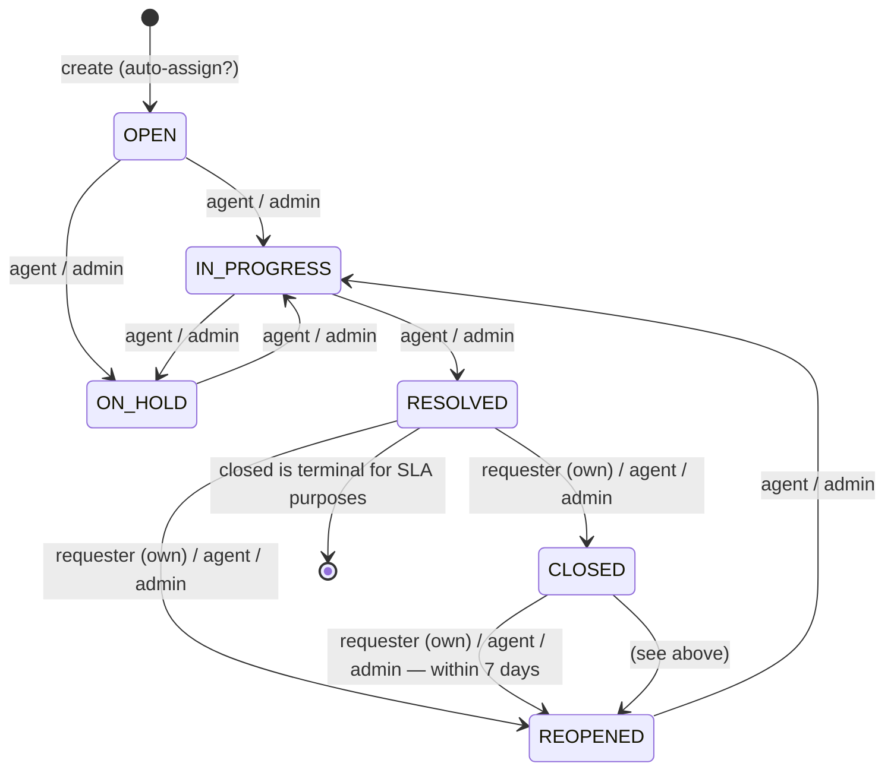

# Workflows — DeskFlow

Ticket lifecycle, status state machine, timestamps, SLA math, auto-assignment, audit actions, notifications, reopen rules.
Enum values must match [DATABASE_SCHEMA §1](DATABASE_SCHEMA.md#1-enum-types) exactly.

## 1. Lifecycle state diagram



Rules of thumb: **only agents and admins move work forward** (`IN_PROGRESS`, `ON_HOLD`, `RESOLVED`); **requesters can only close or reopen tickets they own**, and reopening from `CLOSED` is time-boxed by `REOPEN_WINDOW_DAYS` (default 7).

## 2. Who can act on what

| Role | Ticket visibility | May transition | May assign |
|---|---|---|---|
| `requester` | only tickets where `requester_id = me` (foreign ids → `404`) | `RESOLVED→CLOSED`, `RESOLVED→REOPENED`, `CLOSED→REOPENED` — **own tickets only** | never |
| `agent` | all tickets | every allowed transition except none extra: `OPEN→IN_PROGRESS`, `OPEN→ON_HOLD`, `IN_PROGRESS→ON_HOLD`, `ON_HOLD→IN_PROGRESS`, `IN_PROGRESS→RESOLVED`, `REOPENED→IN_PROGRESS`, plus `RESOLVED→CLOSED/REOPENED`, `CLOSED→REOPENED` | self-assign only |
| `admin` | all tickets | same as agent | assign anyone, unassign, self-assign |

Enforcement: `POST /api/v1/tickets/{id}/status` checks (1) ticket exists + visible, (2) transition is in the table below, (3) the caller's role is allowed for that transition. Any failure is a `409 INVALID_TRANSITION` (bad pair) or `403 FORBIDDEN` (role) — see [API_SPEC §8](API_SPEC.md#8-tickets-apiv1tickets).

## 3. Transition table

| # | From | To | requester¹ | agent | admin |
|---|---|---|---|---|---|
| T1 | `OPEN` | `IN_PROGRESS` | ✗ | ✓ | ✓ |
| T2 | `OPEN` | `ON_HOLD` | ✗ | ✓ | ✓ |
| T3 | `IN_PROGRESS` | `ON_HOLD` | ✗ | ✓ | ✓ |
| T4 | `ON_HOLD` | `IN_PROGRESS` | ✗ | ✓ | ✓ |
| T5 | `IN_PROGRESS` | `RESOLVED` | ✗ | ✓ | ✓ |
| T6 | `RESOLVED` | `CLOSED` | ✓ | ✓ | ✓ |
| T7 | `RESOLVED` | `REOPENED` | ✓ | ✓ | ✓ |
| T8 | `CLOSED` | `REOPENED` | ✓ | ✓ | ✓ ² |
| T9 | `REOPENED` | `IN_PROGRESS` | ✗ | ✓ | ✓ |

¹ Requester entries apply only when `ticket.requester_id = caller.id`; otherwise `403`.
² Only within `REOPEN_WINDOW_DAYS` (default **7**) of entering `CLOSED` — measured from the `STATUS_CHANGED → CLOSED` audit timestamp. Outside the window → `409 REOPEN_WINDOW_EXPIRED`.

Every other pair (including `OPEN→RESOLVED`, `OPEN→CLOSED`, `ON_HOLD→RESOLVED`, `REOPENED→CLOSED`, self-transitions) → `409 INVALID_TRANSITION` with `details[0].issue = "Allowed next statuses: <list>"`.

### 3.2 Side effects

Executed in one DB transaction with the status update (service: `ticket_service.transition`):

| Side effect | Trigger |
|---|---|
| `audit_logs` row `STATUS_CHANGED`, `old_value={"status": from}`, `new_value={"status": to}` | always |
| `updated_at = now()` | always |
| optional `note` stored as a comment by the caller (public for every role) | `note` present and non-empty |
| `first_responded_at = now()` **iff currently null** and actor role ∈ {agent, admin} | to ∈ {`IN_PROGRESS`, `ON_HOLD`, `RESOLVED`} |
| `paused_at = now()` | to = `ON_HOLD` |
| resume: `delta = now() − paused_at`; `total_paused_seconds += delta`; `first_response_due_at += delta`; `resolution_due_at += delta`; `paused_at = null` | from = `ON_HOLD` |
| `resolved_at = now()` **iff currently null** | to = `RESOLVED` |
| notification `STATUS_CHANGED` → requester | to = `RESOLVED` |
| notification `STATUS_CHANGED` → assignee (if any) | to = `REOPENED` |
| notification `STATUS_CHANGED` → assignee (if any) | to = `CLOSED` |

Notes:
- Requester-driven transitions (T6/T7/T8) never set `first_responded_at` (the requester is not a responder).
- A `note` written by an agent/admin counts as a first response only because the transition itself sets `first_responded_at` (the comment alone — see §4.2 — would also do it).
- `resolved_at` and the SLA due dates are **never cleared** on reopen; the ticket keeps its clock (see §10).

## 4. Timestamps

### 4.1 Set on create

| Column | Value |
|---|---|
| `created_at`, `updated_at` | `now()` |
| `first_response_due_at` | `created_at + first_response_minutes(priority)` from `sla_policies` |
| `resolution_due_at` | `created_at + resolution_minutes(priority)` from `sla_policies` |
| `total_paused_seconds` | `0` |
| `sla_breached` | `false` |

### 4.2 First response

`first_responded_at` is set (once, only if `NULL`) by the **earliest** of:

1. a **public** comment (`is_public=true`) authored by an agent or admin; or
2. a transition to `IN_PROGRESS`, `ON_HOLD` or `RESOLVED` performed by an agent or admin (T1–T5, T9).

Explicitly **not** a first response: requester comments, internal notes (`is_public=false`), requester transitions, ticket creation.

First-response SLA: **met** iff `first_responded_at <= first_response_due_at` (due date as shifted by pauses), **breached** iff `first_responded_at IS NULL AND now() > first_response_due_at`.

### 4.3 Pause / resume

- **Enter ON_HOLD (T2, T3):** `paused_at = now()`. The SLA clock is frozen from this instant; the UI shows "Paused".
- **Leave ON_HOLD (T4):** `delta = paused_seconds(now, paused_at)`; then `total_paused_seconds += delta`, both due dates shifted `+= delta`, `paused_at = NULL`.
- Multiple ON_HOLD episodes accumulate in `total_paused_seconds`; each shift is applied at resume time, so stored due dates are always "real-world deadlines" usable directly as `due_at − now`.

## 5. SLA calculation algorithm

### 5.1 Inputs

- `sla_policies[priority] → (first_response_minutes, resolution_minutes)`
- ticket columns: `created_at`, `first_response_due_at`, `resolution_due_at`, `first_responded_at`, `resolved_at`, `paused_at`, `total_paused_seconds`, `sla_breached`
- settings: `SLA_AT_RISK_THRESHOLD = 0.75`
- `now = datetime.now(timezone.utc)` (all arithmetic in UTC)

### 5.2 Computed SLA state (on read — `sla_state`)

```
function sla_state(t, now, threshold=0.75):
    frozen = t.total_paused_seconds
    if t.paused_at is not null:
        frozen += (now - t.paused_at).seconds          # clock currently frozen

    elapsed_fr = seconds_between(t.created_at, now) - frozen      # time used vs first response
    elapsed_rs = seconds_between(t.created_at, now) - frozen      # time used vs resolution

    fr_target = t.first_response_minutes * 60
    rs_target = t.resolution_minutes * 60        # = (resolution_due_at - created_at) + frozen shifts

    worst = ON_TRACK
    for (target, elapsed, done) in [(fr_target, elapsed_fr, t.first_responded_at),
                                    (rs_target, elapsed_rs, t.resolved_at)]:
        if done is not null:                      # target already achieved — evaluate at completion time
            if seconds_between(t.created_at, done) - frozen_at(done) > target:
                worst = BREACHED
            elif seconds_between(t.created_at, done) - frozen_at(done) >= threshold * target:
                worst = max(worst, AT_RISK)       # AT_RISK only if never breached
        else:
            if elapsed > target:
                worst = BREACHED
            elif elapsed >= threshold * target:
                worst = max(worst, AT_RISK)
    return worst
```

Simplifications the implementation uses (equivalent, cheaper):

- If `first_responded_at`/`resolved_at` exists, check `first_responded_at <= first_response_due_at` / `resolved_at <= resolution_due_at` (due dates already include pause shifts) — this is the same test as above because due dates were shifted by exactly the frozen time.
- If not yet achieved: `used_ratio = elapsed_effective / target`; `> 1.0` → `BREACHED`, `>= 0.75` → `AT_RISK`, else `ON_TRACK`.
- The **ticket's** `sla_state` = worst of the two targets (first-response + resolution).
- `sla_state` is derived on every read (`GET /tickets`, `GET /tickets/{id}`, `GET /dashboard/recent-tickets`) — never stored, never stale.

### 5.3 Worked examples (priority `HIGH` = 240 min first response / 1440 min resolution)

**Example A — straight through**

- Created `10:00`. Due: FR `14:00`, RS `10:00 + 24h = next day 10:00`.
- Agent comments `11:30` → `first_responded_at = 11:30` (90 min ≤ 240 → FR met).
- Resolved next day `08:00` (22 h ≤ 24 h → RS met). `sla_state = ON_TRACK` throughout.

**Example B — ON_HOLD pause**

- Created `10:00`. Due: FR `14:00`, RS next day `10:00`.
- No response yet; ticket put `ON_HOLD` at `12:00` (elapsed 2 h → `AT_RISK` just before the hold).
- Resumed `18:00` → `delta = 6 h = 21600 s`; `total_paused_seconds = 21600`; due dates shift: FR → `20:00`, RS → next day `16:00`.
- Agent comments `19:00` → FR elapsed effective = `19:00 − 10:00 − 6 h = 3 h ≤ 4 h` → met (a naive `due − now` would also say `20:00 > 19:00` ✓ — both agree because the due date was shifted).
- While paused (12:00–18:00) the UI shows "Paused" (it checks `paused_at != null`), and `elapsed_effective` stays constant at 2 h.

**Example C — breach + at risk**

- Created `09:00`, priority `CRITICAL` (FR 60 min, RS 240 min). Due FR `10:00`, RS `13:00`.
- No agent action. At `09:45`: elapsed 45/60 = 0.75 → `AT_RISK` (notification `SLA_AT_RISK` to assignee, deduped).
- At `10:01`: FR breached. If the ticket is read/scanned then: `sla_breached = true` (persisted once), audit `SLA_BREACHED` (actor `NULL` = system), notifications `SLA_BREACHED` → assignee + requester.
- Resolved `13:30` → RS also late; `resolved_at` kept, `sla_state` stays `BREACHED` for the KPIs.

**Example D — reopened late**

- Resolved on time, then reopened on day 6. `resolved_at` stays, due dates unchanged. As long as the ticket is not resolved again, the resolution clock keeps running against the original (shifted) due date → likely `BREACHED` on next read. That is intentional: an unresolved reopened ticket is over target.

### 5.4 Breach & at-risk detection

Two mechanisms, same logic:

1. **On read/mutation (primary):** whenever a ticket is serialized (`GET /tickets`, `GET /tickets/{id}`, `POST .../status`, `POST .../comments`), `sla_state` is computed; if any target is breached and `sla_breached == false`, the service persists `sla_breached = true`, writes audit `SLA_BREACHED` (`actor_id = NULL`), and creates `SLA_BREACHED` notifications (assignee + requester, deduped). If `used_ratio ≥ 0.75` and not breached, an `SLA_AT_RISK` notification is created for the assignee (deduped against any unread one of the same type for the same ticket).
2. **Periodic scan (secondary):** `POST /api/v1/internal/sla-scan` with header `X-SLA-Scan-Secret` runs the same routine over all tickets with `status ∈ {OPEN, IN_PROGRESS, ON_HOLD, REOPENED}` — catches tickets nobody looks at. Callable by any external scheduler; optional for MVP ([API_SPEC §12](API_SPEC.md#12-internal-apiv1internal)).

`sla_breached` is **append-only** (set once, never reset) so historical KPIs stay honest.

## 6. Auto-assignment

Runs inside the `POST /tickets` transaction when `auto_assign == true` (default) and no assignee is set:

```
function pick_least_loaded_agent(db, exclude=None):
    candidates = users where role in ('agent','admin') and is_active = true and id != exclude
    if candidates empty: return null
    for each candidate: load = count(tickets where assignee_id = candidate
                                     and status in (OPEN, IN_PROGRESS, ON_HOLD, REOPENED))
    pick the candidate with (load ASC, created_at ASC)      # tie → most senior account
    return pick
```

- Deterministic and cheap (one grouped `COUNT` query + the candidate query).
- On success: `assignee_id = pick`, `auto_assigned = true`, audit `AUTO_ASSIGNED` (`actor_id = NULL`, `old_value = null`, `new_value = {"assignee_id": ...}`), notifications per §9.
- On no candidates (no active agents): leave unassigned — not an error; the ticket shows in the **Unassigned** tab.
- Admin-configurable opt-out per request via `auto_assign: false` (checkbox on `/tickets/new`).

## 7. Audit log actions

One row per mutation, written in the **same transaction** as the change (`audit_service.record(actor, action, entity_type, entity_id, ticket_id, old_value, new_value)`). `entity_type` ∈ `ticket | user | category | sla_policy`.

| `action` | Written when | `old_value` → `new_value` | actor |
|---|---|---|---|
| `TICKET_CREATED` | ticket created | `null` → `{"ticket_number","title","priority","status"}` | caller |
| `AUTO_ASSIGNED` | auto-assigner claimed a new ticket | `{"assignee_id": null}` → `{"assignee_id": ...}` | `NULL` (system) |
| `TICKET_UPDATED` | requester/agent edits title/description | changed fields only | caller |
| `STATUS_CHANGED` | any transition | `{"status": from}` → `{"status": to}` | caller |
| `PRIORITY_CHANGED` | `PATCH` priority | `{"priority": "MEDIUM"}` → `{"priority": "HIGH"}` | caller |
| `CATEGORY_CHANGED` | `PATCH` category | `{"category_id": ...}` → `{"category_id": ...}` | caller |
| `ASSIGNED` | self-assign or admin assign | `{"assignee_id": null}` → `{"assignee_id": ...}` | caller |
| `UNASSIGNED` | admin unassigns | `{"assignee_id": ...}` → `{"assignee_id": null}` | caller |
| `COMMENT_ADDED` | public comment added | `null` → `{"comment_id": ...}` | caller |
| `INTERNAL_NOTE_ADDED` | internal note added | `null` → `{"comment_id": ...}` | caller |
| `SLA_BREACHED` | breach flag first persisted | `{"sla_breached": false}` → `{"sla_breached": true}` | `NULL` (system) |
| `USER_CREATED` | admin creates user | `null` → `{"email","role"}` (never password) | admin |
| `USER_UPDATED` | admin edits user | changed fields (never password) | admin |
| `ROLE_CHANGED` | admin changes a role | `{"role": "agent"}` → `{"role": "admin"}` | admin |
| `USER_DEACTIVATED` | admin deactivates user | `{"is_active": true}` → `{"is_active": false}` | admin |
| `PASSWORD_CHANGED` | self-service password change | `null` → `null` (**values never stored**) | self |
| `CATEGORY_CREATED` / `CATEGORY_UPDATED` / `CATEGORY_DEACTIVATED` | category CRUD | changed fields | admin |
| `SLA_POLICY_UPDATED` | `PUT /sla-policies/{priority}` | `{"resolution_minutes": 1440}` → `{"resolution_minutes": 720}` | admin |

Guards: `audit_logs` is append-only — a Postgres trigger rejects `UPDATE`/`DELETE` ([DATABASE_SCHEMA §3.6](DATABASE_SCHEMA.md#36-audit_logs)).

## 8. Ticket number allocation

`ticket_number = "TCK-" + padded(value)` where value comes from the `counters` row `name='ticket'`:

```sql
UPDATE counters SET value = value + 1 WHERE name = 'ticket' RETURNING value;
```

- Runs inside the ticket-creation transaction (row lock guarantees uniqueness under concurrency); seed starts the counter at `1040`, so the first demo ticket is `TCK-1041`.
- Padding: `TCK-` + the raw integer (no left-padding beyond the natural number, e.g. `TCK-1041`, `TCK-1057`). Rendered in the UI as `#TCK-1041`.
- Uniqueness enforced a second time by `uq_tickets_ticket_number`.

## 9. Notification triggers

| Event | `type` | Recipients | Dedup |
|---|---|---|---|
| Assignment changed (self-assign / admin assign / auto-assign) | `TICKET_ASSIGNED` | new assignee **unless they are the actor**; **always** the requester | no |
| Unassigned | `TICKET_ASSIGNED` | requester (title "TCK-#### was unassigned") | no |
| Public comment added | `COMMENT_ADDED` | if author is requester → assignee (if any); if author is agent/admin → requester | no |
| Status → `RESOLVED` | `STATUS_CHANGED` | requester | no |
| Status → `REOPENED` | `STATUS_CHANGED` | assignee (if any) | no |
| Status → `CLOSED` | `STATUS_CHANGED` | assignee (if any) | no |
| SLA ≥ 75% used | `SLA_AT_RISK` | assignee (if any) | skip if unread `(user, SLA_AT_RISK, ticket)` exists |
| SLA breached | `SLA_BREACHED` | assignee (if any) + requester | skip if unread `(user, SLA_BREACHED, ticket)` exists |

Rules: never notify inactive users; never notify the actor about their own action; requester recipients are always limited to their own tickets. Frontend polls `GET /notifications/unread-count` every 30 s.

## 10. Reopen rules

1. Allowed only from `RESOLVED` (T7) or `CLOSED` (T8). `REOPENED → CLOSED` is **not** allowed — an agent must resolve it again first.
2. From `CLOSED`, reopening must happen within `REOPEN_WINDOW_DAYS` (default 7) of the close (measured on the `STATUS_CHANGED → CLOSED` audit row); after that → `409 REOPEN_WINDOW_EXPIRED` and the UI disables the button with an explanatory tooltip.
3. On reopen: status `REOPENED`, audit `STATUS_CHANGED`, `STATUS_CHANGED` notification to the assignee. `resolved_at`, `first_responded_at` and both due dates are **kept** — the original targets still apply (Example D above).
4. A reopened ticket lands in the agent queue with its previous assignee (or unassigned) and is counted in `unassigned`/queue KPIs like any open work.
5. Subsequent resolution (T5 after T9) reuses the same due dates; because `resolved_at` was already set, SLA compliance for the ticket reflects the **first** resolution (documented simplification).
